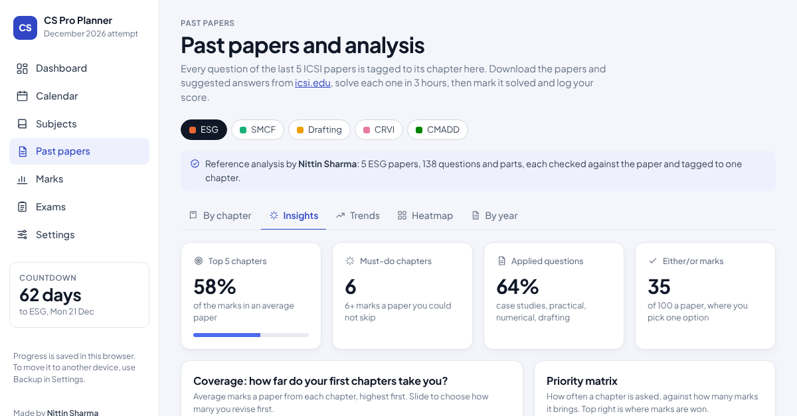

# CS Pro Planner – CS Professional, December 2026

A free study planner for ICSI CS Professional students, made by **Nittin Sharma**.

**Open it:** https://nittinsh.github.io/cs-pro-planner/

## What it does

- **Day-by-day plan from 21 October to the exams**, built around office hours: detailed revision with two subjects a day, 100-mark papers, one subject a day, a catch-up day, then the magic plan in reverse exam order.
- **Past-paper analysis** of all five compulsory papers (ESG, Drafting, CMADD, SMCF, CRVI) across June 2024, Dec 2024, June 2025, Dec 2025 and June 2026. Every question is tagged to its chapter.
- **Insights:** how much of the paper the top chapters cover, a priority matrix, a ranked priority list, and concepts ICSI asks again and again.
- **Trends:** rising and falling chapters, applied vs theory questions, and a trend line for every chapter.
- **Practice tests:** 20-mark chapter tests and 100-mark papers laid out exactly like real ICSI papers, built from the past questions so none repeats. On claude.ai, Claude rewrites each question with new facts and adds marking points.
- **Strategy from past marksheets:** enter the marks of each earlier attempt; see each paper's trend, how many marks short each group was, a focus order with the must-do chapters, and give weak papers more time in the plan.
- **Past papers by chapter**, chapter progress, notes, flags, recall checks, study evidence, exam checklist, focus timer and Google Calendar export.

## Your data

Everything you enter is saved in your own browser. Use **Settings → Backup** to move it to another device.
Download the official question papers and suggested answers from [icsi.edu](https://www.icsi.edu).

## Hosting

A single static page (`index.html`), served by GitHub Pages.
